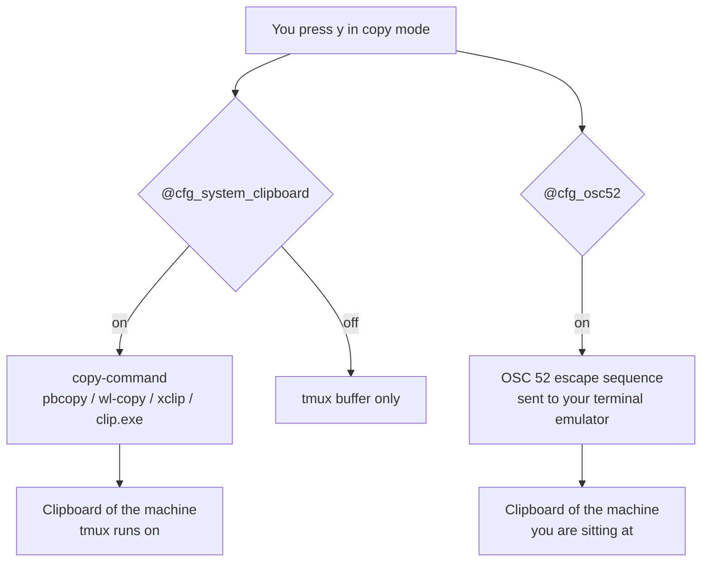

# Configuration

Everything tunable lives in **`config/00-options.conf`**. Open it, change a
value, press ++ctrl+b++ ++r++.

```tmux
set -g @cfg_theme "nord"
```

Each option in that file carries its accepted values and the reasoning behind
its default. This page explains the ones with tradeoffs worth understanding.
For a bare list of every option, see the [Options reference](../reference/options.md).

---

## How a setting reaches tmux

You set `@cfg_*` options; modules translate them into real tmux settings. Two
mechanisms are used, both of which run without spawning a shell:

```tmux
# Pass a value straight through
set -gF mouse "#{@cfg_mouse}"

# Branch when a setting needs more than one line
%if "#{==:#{@cfg_dim_inactive},on}"
  setw -g window-style        "fg=colour247"
  setw -g window-active-style "fg=colour255"
%endif
```

!!! danger "The `-F` flag is not optional"
    `set -g mouse "#{@cfg_mouse}"` stores the **literal text** `#{@cfg_mouse}`.
    Only `set -gF` expands the format. This is the single most common bug when
    extending this config, and tmux reports no error when you get it wrong.

The `%if` mechanism has a sharp edge that shapes the whole file layout — see
[Architecture → The `%if` trap](../architecture.md#the-if-trap).

---

## Prefix

```tmux
set -g @cfg_prefix "C-b"
set -g @cfg_keep_default_prefix "off"
```

++ctrl+b++ is the default and collides with nothing. ++ctrl+a++ is the classic
alternative — easier to reach, but it takes over "jump to start of line" in
every shell and readline program inside your panes. If you switch, press it
twice to send it through.

Setting `@cfg_keep_default_prefix` to `on` keeps ++ctrl+b++ working as a second
prefix, which makes the transition painless.

---

## Behaviour

### Escape time

```tmux
set -g @cfg_escape_time "10"
```

How long tmux waits after ++esc++ to see whether it begins an escape sequence.

**tmux's own default is 500 ms, and it is the reason Neovim feels sluggish
inside tmux** — every time you leave insert mode, you wait half a second. `10`
is responsive and still safe over SSH. Set it to `0` only on a local machine.

### Window numbering

```tmux
set -g @cfg_base_index "1"
set -g @cfg_renumber_windows "off"
```

`base-index 1` lines the window numbers up with the number row on your
keyboard. tmux defaults to `0`, which puts window 0 at the far end.

`renumber-windows off` means a window keeps its number for the whole session.
Closing window 2 leaves a gap rather than renumbering 3 → 2. This is
deliberate: it keeps ++alt+3++ pointing at the same window all day. Turn it on
if you prefer a gapless list.

### Scrollback

```tmux
set -g @cfg_history_limit "10000"
```

Per pane, not per session. Twenty panes at 50 000 lines is a lot of memory —
`10000` is a good balance. Raise it if you regularly scroll back through long
build logs.

### Alt-number window switching

```tmux
set -g @cfg_alt_window_keys "on"
```

++alt+1++ … ++alt+9++ jump straight to a window with no prefix.

!!! warning "This takes the keys globally"
    Bindings without a prefix are intercepted by tmux **before** the program in
    your pane sees them. ++alt+number++ is used by terminal browsers, some TUI
    applications, and Windows Terminal's own tab switching. If you live in
    those, set this to `off` and use ++ctrl+b++ ++1++ instead.

---

## Copy mode & clipboard

### What copy mode is not

```tmux
set -g @cfg_mode_keys "vi"
```

This gives you `v` / `y` / ++ctrl+v++ inside tmux's copy mode. It has **no
effect on Neovim, your shell, or anything running in a pane** — copy mode is a
separate tmux mode with its own key table. Setting `mode-keys vi` does not make
tmux "vi flavoured" in general.

Enter copy mode with ++ctrl+b++ ++bracket-left++ or by scrolling up with the
mouse; leave it with ++q++.

### The two clipboard paths

There are two independent routes from tmux to your clipboard. Knowing which one
is working saves a lot of debugging.



**`copy-command`** runs a local helper. Over SSH, "local" means the *remote*
host — which is almost never the clipboard you want.

**OSC 52** asks your terminal emulator to set the clipboard. Because the
terminal runs on your own machine, this is what makes copying work across SSH.

Both are on by default; they complement each other.

```tmux
set -g @cfg_system_clipboard "on"
set -g @cfg_osc52 "on"
```

Platform detection is automatic and ordered deliberately: WSL is checked before
Linux, because a WSL system reports `Linux` from `uname` and may even have
`xclip` installed — but the clipboard you actually see is the Windows one.

!!! note "Terminal support for OSC 52"
    Ghostty, kitty, WezTerm, Alacritty, foot, iTerm2, and Windows Terminal
    support it. **macOS Terminal.app does not.** See
    [Troubleshooting → Clipboard](../reference/troubleshooting.md#copying-does-not-reach-my-clipboard).

### Pasting

++ctrl+b++ ++p++ pastes tmux's own buffer. To paste from the OS clipboard, use
your terminal's normal shortcut (++cmd+v++ / ++ctrl+shift+v++) — that path does
not involve tmux at all.

---

## Appearance

### Theme

```tmux
set -g @cfg_theme "catppuccin-mocha"
```

Six themes ship with the config. Writing your own is a twenty-line file —
see [Theming](../customization/themes.md).

### Status bar

```tmux
set -g @cfg_status_style    "default"    # minimal | default | detailed
set -g @cfg_status_position "bottom"     # bottom | top
set -g @cfg_clock_format    "%H:%M"
set -g @cfg_date_format     "%d.%m.%Y"   # "" hides the date
```

| Preset | Shows |
| --- | --- |
| `minimal` | Session name and windows only |
| `default` | Adds clock and date |
| `detailed` | Adds hostname and the detected platform |

Both time formats accept any `strftime` string. Setting `@cfg_date_format` to
`""` collapses the date segment and its separator cleanly.

### Status bar performance

```tmux
set -g @cfg_status_interval "5"
```

**This is the most performance-sensitive number in the config.**

The default status bar contains no `#(shell command)`, so a refresh only
re-renders text — cheap at any interval. The moment you add a `#()`, tmux forks
a process **every interval, for every attached client**. A git-branch indicator
at `status-interval 1` means a `git` process every second, forever.

If you add one:

```tmux
# In local.conf
set -g status-interval 15
set -ag status-right "#[fg=#{@thm_subtle}]#(cd #{pane_current_path} && git branch --show-current 2>/dev/null) "
```

Rules of thumb:

- No `#()` → any interval is fine.
- With `#()` → 15 s or slower, and keep the command under ~50 ms.
- Never combine `status-interval 1` with `#()`.

### Pane borders

```tmux
set -g @cfg_pane_border_lines "single"
set -g @cfg_dim_inactive "off"
```

`single` renders correctly in every terminal and font. `double` and `heavy`
need good box-drawing glyphs and look broken in some terminals.

`@cfg_dim_inactive` greys out unfocused panes. It costs nothing, but it looks
muddy on low-contrast themes — try it and see.

---

## Local overrides

`local.conf` sits next to `tmux.conf`, is loaded **last**, and is gitignored.
Anything in it wins.

```bash
cp ~/.config/tmux/local.conf.example ~/.config/tmux/local.conf
```

That example file is not empty boilerplate — it ships every
[recipe](../customization/recipes.md) already written and commented out: popups for lazygit and
man pages, an fzf session switcher, a git branch in the status bar, per-host
settings. Uncomment what you want.

Use it for anything you want to **add**:

```tmux
# An extra binding
bind -N "Open lazygit" G display-popup -E -w 90% -h 90% -d "#{pane_current_path}" lazygit

# Override one theme colour without copying a whole theme
set -g @thm_accent "#ff8800"
set -g pane-active-border-style "fg=#{@thm_accent}"

# Machine-specific settings
if-shell -b '[ "$(hostname -s)" = "work-laptop" ]' \
  'set -g status-position top'
```

!!! tip "Prefer local.conf over editing 00-options.conf"
    Overriding `set -g @cfg_theme "nord"` in `local.conf` works exactly as well
    as editing the options file, and it means `git pull` can never produce a
    conflict.

---

## Applying changes

| Situation | What to do |
| --- | --- |
| Changed an option | ++ctrl+b++ ++r++ |
| Changed the theme | ++ctrl+b++ ++r++ |
| Changed something that will not take | `tmux kill-server` and start again |

Some settings — `escape-time`, `default-terminal`, and a few window options —
apply to panes only when they are created. A reload updates the setting, but
existing panes keep the old value until you make a new one. When in doubt,
`kill-server` is the definitive test.
