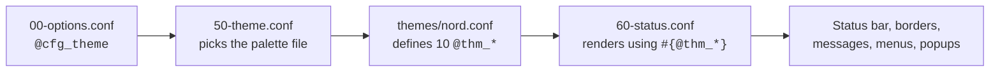

# Theming

## Switching theme

```tmux title="config/00-options.conf"
set -g @cfg_theme "nord"
```

Press ++ctrl+b++ ++r++. That is the whole procedure.

| Value | Palette |
| --- | --- |
| `catppuccin-mocha` | Catppuccin Mocha — dark, blue accent *(default)* |
| `catppuccin-latte` | Catppuccin Latte — light |
| `tokyonight` | Tokyo Night — dark, blue accent |
| `nord` | Nord — dark, cyan accent, low contrast |
| `gruvbox-dark` | Gruvbox Dark — warm, retro |
| `rose-pine` | Rosé Pine — dark, purple accent |
| `custom` | Your own, from `config/themes/custom.conf` |

---

## How theming works here

A theme defines **ten colour variables and nothing else**. It contains no
layout, no separators, and no status bar markup.

```tmux title="config/themes/nord.conf"
set -g @thm_bg      "#2e3440"
set -g @thm_surface "#3b4252"
set -g @thm_fg      "#eceff4"
set -g @thm_muted   "#d8dee9"
set -g @thm_subtle  "#4c566a"
set -g @thm_accent  "#88c0d0"
set -g @thm_urgent  "#bf616a"
set -g @thm_warn    "#ebcb8b"
set -g @thm_ok      "#a3be8c"
set -g @thm_border  "#3b4252"
```

`config/60-status.conf` then builds the entire status bar in terms of those
names — no hex value appears in it:

```tmux
set -g status-style "bg=#{@thm_bg},fg=#{@thm_fg}"
set -g pane-active-border-style "fg=#{@thm_accent}"
```

That indirection is why switching themes is one word, and why a new theme
cannot accidentally break your layout.



---

## The ten variables

| Variable | Used for | Pick something that… |
| --- | --- | --- |
| `@thm_bg` | Status bar background | matches or slightly differs from your terminal background |
| `@thm_surface` | Raised blocks: active window, messages, menus | is one step lighter than `bg` |
| `@thm_fg` | Primary text | has strong contrast against `bg` |
| `@thm_muted` | Inactive window names, clock | is readable but recedes |
| `@thm_subtle` | Separators, window numbers, borders | is barely visible — this is structure, not content |
| `@thm_accent` | Session name, active window, active border | is your one signature colour |
| `@thm_urgent` | Bells, armed prefix indicator | is red-ish and unmistakable |
| `@thm_warn` | Activity in a background window | is amber-ish |
| `@thm_ok` | Zoom indicator, copy-mode marks | is green-ish |
| `@thm_border` | Inactive pane borders | is close to `surface` |

Only `@thm_accent` and `@thm_subtle` really decide the character of the theme.
The rest follow from your terminal colours.

---

## Writing your own theme

```bash
cp ~/.config/tmux/config/themes/catppuccin-mocha.conf \
   ~/.config/tmux/config/themes/custom.conf
```

Edit the ten hex values, then:

```tmux title="config/00-options.conf"
set -g @cfg_theme "custom"
```

`custom.conf` is gitignored, so it survives updates.

### Adding a named theme

To ship a theme under its own name rather than as `custom`, add the file and
register it in `config/50-theme.conf`:

```tmux
%if "#{==:#{@cfg_theme},dracula}"
  source-file -q "~/.config/tmux/config/themes/dracula.conf"
%endif
```

!!! question "Why a `%if` chain instead of building the path from the name?"
    Because `source-file` does not expand formats — `source-file
    "themes/#{@cfg_theme}.conf"` looks up a directory literally named
    `#{@cfg_theme}`. The chain is verbose but resolves at parse time and costs
    no shell forks. See [Architecture](../architecture.md#why-the-theme-loader-looks-like-that).

---

## Overriding a single colour

You rarely need a whole theme to change one thing. Theme variables are ordinary
tmux options, so `local.conf` can override any of them — but you must also
re-apply anything that already consumed the old value:

```tmux title="local.conf"
set -g @thm_accent "#ff8800"

# Re-apply the consumers
set -g pane-active-border-style "fg=#{@thm_accent}"
set -g status-left "#{?client_prefix,#[bg=#{@thm_urgent}],#[bg=#{@thm_accent}]}#[fg=#{@thm_bg},bold] #S #[default] "
```

This is the one place the indirection leaks: `60-status.conf` has already been
parsed by the time `local.conf` runs, so the strings it built still hold the
old colour.

---

## Icons and separators

The status bar deliberately uses characters that render in **any** font — a
`•` between clock and date, `│` as a separator. No Nerd Font is required.

If you do have a patched font, powerline separators are a `local.conf` change:

```tmux title="local.conf"
set -g window-status-current-format \
  "#[fg=#{@thm_surface},bg=#{@thm_bg}]#[fg=#{@thm_accent},bg=#{@thm_surface},bold] #I #[fg=#{@thm_fg}]#W #[fg=#{@thm_surface},bg=#{@thm_bg}]"
```

!!! warning "Check your locale before relying on any non-ASCII glyph"
    Without a UTF-8 locale, tmux replaces these characters with `_`. See
    [Troubleshooting](../reference/troubleshooting.md#status-bar-shows-underscores).

---

## Previewing every theme

```bash
for t in catppuccin-mocha catppuccin-latte tokyonight nord gruvbox-dark rose-pine; do
  sed -i.bak "s|^set -g @cfg_theme .*|set -g @cfg_theme \"$t\"|" \
    ~/.config/tmux/config/00-options.conf
  tmux source-file ~/.config/tmux/tmux.conf
  echo "Now showing: $t — press Enter for the next one"
  read _
done
rm -f ~/.config/tmux/config/00-options.conf.bak
```

Run it from inside a tmux session.
