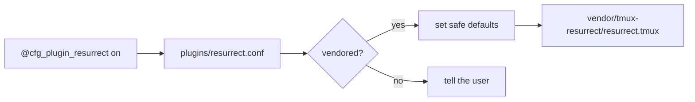

# Plugins

**Plugins are off by default, and nothing in this config depends on one.**

Theming, clipboard, copy mode, capability detection and the status bar are all
plain tmux. Turn a plugin on when you want a specific capability — not as a
starting point.

---

## No plugin manager

Plugins ship **inside this repository** under `vendor/`, added with
`git subtree` and pinned in `vendor-manifest/plugins.toml`. There is no TPM.

| Consequence | Why it matters |
| --- | --- |
| tmux downloads nothing at startup | Clone once, then it works offline |
| Versions are pinned and traceable | You can say which plugin shipped in release 1.2.0 |
| Upstream cannot change your setup | A force-push does not alter your terminal tomorrow |
| No runtime dependency | Nothing to install, nothing to break |

You update plugins by updating **this** repo:

```bash
cd ~/.config/tmux && git pull
```

That brings a plugin snapshot that was tested together with the config.

---

## Enabling a plugin

```tmux title="config/00-options.conf"
set -g @cfg_plugins           "on"    # master switch
set -g @cfg_plugin_resurrect  "on"
```

Reload with <kbd>prefix</kbd> <kbd>R</kbd>. No install step, no
<kbd>prefix</kbd> <kbd>I</kbd>.

If a plugin is enabled but not vendored, tmux says so on startup rather than
doing nothing silently.

---

## What ships

```bash
./scripts/update-vendor --list
```

| Plugin | Option | Purpose |
| --- | --- | --- |
| tmux-resurrect | `@cfg_plugin_resurrect` | Save/restore sessions across reboots |
| tmux-continuum | `@cfg_plugin_continuum` | Automatic save + restore on start |
| vim-tmux-navigator | `@cfg_plugin_navigator` | Shared Neovim/tmux pane navigation |
| tmux-open | `@cfg_plugin_open` | Open a file or URL from copy mode |
| tmux-sessionist | `@cfg_plugin_sessionist` | Extra session management — **see the conflicts below** |

### tmux-resurrect

| Key | Action |
| --- | --- |
| <kbd>prefix</kbd> <kbd>Ctrl</kbd>+<kbd>s</kbd> | Save |
| <kbd>prefix</kbd> <kbd>Ctrl</kbd>+<kbd>r</kbd> | Restore |

The restored-process list is deliberately short
(`ssh psql mysql sqlite3 top htop btop`). Restoring arbitrary commands at boot
re-runs whatever happened to be in a pane, which is a genuine footgun.

### tmux-continuum

Requires resurrect. It is **not** enabled for you automatically:

```tmux
set -g @cfg_plugin_resurrect "on"   # both, explicitly
set -g @cfg_plugin_continuum "on"
```

Enable continuum alone and you get a message explaining the dependency.
Silently switching on a second plugin because you asked for the first is
exactly the hidden behaviour this project avoids.

```{note} Why it is opt-in
It keeps a background process alive for the life of the server and writes
to disk on a timer.
```
### vim-tmux-navigator

See [Neovim](../integration/neovim.md). This is the one plugin that intercepts application
input, and `scripts/check` reports it as such when enabled — correctly.

---

## Adapters

Nothing in `vendor/` is sourced directly. Each plugin is loaded through an
adapter in `plugins/`, which:

1. checks the `@cfg_plugin_*` option
2. checks the vendored copy is present
3. sets conservative defaults **before** loading
4. loads the entrypoint



That indirection is what keeps integration under this project's control rather
than the plugin's.

---

## Vendoring a new plugin (maintainers)

Add an entry to `vendor-manifest/plugins.toml`, then:

```bash
./scripts/update-vendor --add tmux-resurrect
```

The script runs `git subtree add`, records the synced commit and date back into
the manifest, and copies the plugin's licence into
`vendor-manifest/licenses/`.

Updating:

```bash
./scripts/update-vendor --pull tmux-resurrect
./scripts/update-vendor --pull-all
```

```{warning} Needs a git repository
`git subtree` requires a repo with at least one commit:

```bash
git init && git add -A && git commit -m "Initial commit"
```

`--list` works without one.
```
Then write an adapter in `plugins/<name>.conf` following the existing ones, add
its option to `config/00-options.conf`, and source it from
`config/70-plugins.conf`. `scripts/check` fails if an option is used but never
defined.

---

(binding-conflicts)=
## Binding conflicts

A plugin can silently rebind a key this config already uses. The failure mode is
a key that quietly does something else after you enable a plugin, which is
unpleasant to debug.

```{warning} `scripts/check` cannot catch these
It runs with the shipped defaults, where every plugin is off. Conflict
detection lives in `./tests/run`, which enables each vendored plugin and
diffs the prefix key table against the baseline.

```bash
./tests/run     # see the "Plugin binding overrides" section
```
```
The overrides in the currently vendored snapshot:

### tmux-sessionist — five overrides

| Key | This config | tmux-sessionist |
| --- | --- | --- |
| <kbd>S</kbd> | `choose-tree -Zs` (session chooser) | `switch-client -l` |
| <kbd>g</kbd> | floating scratch terminal | goto-session prompt |
| <kbd>@</kbd> | join a pane from another window | promote pane to a session |
| <kbd>C</kbd> | tmux default `customize-mode` | new-session prompt |
| <kbd>t</kbd> | tmux default `clock-mode` | join pane |

Losing <kbd>prefix</kbd> <kbd>g</kbd> and <kbd>prefix</kbd> <kbd>S</kbd> is the
part most people notice. Restore them in `local.conf`, which loads after the
plugins:

```tmux title="local.conf"
bind -N "Choose a session from a list" S choose-tree -Zs
bind -N "Toggle a floating scratch terminal" g \
  display-popup -E -w 80% -h 75% -d "#{pane_current_path}"
```

### vim-tmux-navigator — one override

| Key | This config | vim-tmux-navigator |
| --- | --- | --- |
| <kbd>Ctrl</kbd>+<kbd>l</kbd> | `next-window` (with prefix) | passes the key through to Neovim |

That is the intended trade — the plugin exists to route Ctrl-hjkl. Window
switching remains on <kbd>prefix</kbd> <kbd>Ctrl</kbd>+<kbd>h</kbd> for the
previous window, <kbd>Alt</kbd>+number, and <kbd>prefix</kbd> <kbd>n</kbd> /
<kbd>p</kbd>.

It is also the only shipped plugin that intercepts application input globally,
which is why it is off by default — see [Neovim](../integration/neovim.md) and
[Philosophy](../philosophy.md#the-second-exception-vim-tmux-navigator).

### The others

`tmux-resurrect`, `tmux-continuum` and `tmux-open` add no conflicting binding.

---

## Deliberately not included

| Plugin | Why not |
| --- | --- |
| `tmux-sensible` | Sets the same options this config sets explicitly — two sources of truth for one setting, silently fighting. |
| `tmux-yank` | `capabilities/` and `40-clipboard.conf` already cover every platform natively. |
| `tmux-copycat` | tmux 3.1 gained native regex search; upstream says so itself. Native beats plugin. |
| Theme plugins | A theme here is ten variables in a file. |

These decisions are recorded in `vendor-manifest/plugins.toml` so they are not
re-litigated every few months.

---

## Troubleshooting

**Enabled a plugin, nothing happened**
:   It is probably not vendored. Check `./scripts/update-vendor --list`, and
    look for the startup message.

**Plugin binds a key this config already uses**
:   See [Binding conflicts](#binding-conflicts) — this is measured, not guessed.

**tmux got slow**
:   Check whether the plugin adds a `#()` to the status bar — see
    [status bar performance](../configuration/index.md#status-bar-performance).

    ```bash
    time tmux -f ~/.config/tmux/tmux.conf -L bench new-session -d \; kill-server
    ```
