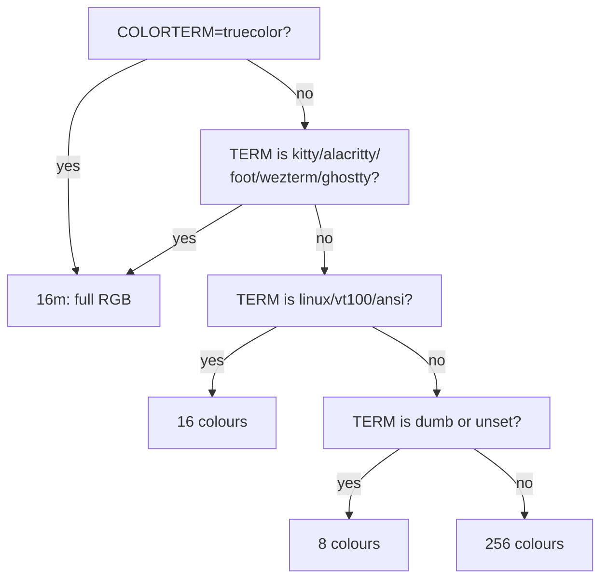

# Capabilities

The config detects what your environment can actually do, and degrades
gracefully when something is missing. This page explains what is detected, how,
and how to override it.

---

## The tri-state

Three settings use `auto` / `on` / `off` rather than a boolean:

```tmux title="config/00-options.conf"
set -g @cfg_truecolor     "auto"
set -g @cfg_symbols       "auto"
set -g @cfg_extended_keys "auto"
```

| Value | Meaning |
| --- | --- |
| `auto` | Follow what was detected. Correct almost always. |
| `on` | Force it, even if detection says no. |
| `off` | Never use it, even if supported. |

`on` exists because detection can be wrong in the conservative direction — a
capable terminal behind a serial link or another multiplexer may export nothing
that proves what it can do.

---

## What gets detected

Run `./scripts/info` to see all of it for your machine.

| Fact | Set to | How |
| --- | --- | --- |
| `@cap_os` | `macos` `linux` `wsl` `bsd` `solaris` `cygwin` | `uname`, `$WSL_DISTRO_NAME`, `/proc/version` |
| `@cap_display` | `wayland` `x11` `none` | `$WAYLAND_DISPLAY`, `$DISPLAY` |
| `@cap_ssh` | `yes` `no` | `$SSH_CONNECTION`, `$SSH_CLIENT`, `$SSH_TTY` |
| `@cap_utf8` | `yes` `no` | `locale charmap` |
| `@cap_truecolor` | `yes` `no` | `$COLORTERM`, then known `$TERM` names |
| `@cap_colors` | `16m` `256` `16` `8` | as above, plus low-colour `$TERM` names |

`@cap_*` are **facts**. `@cfg_*` are **policy**. `@cfg_truecolor "off"` with
`@cap_truecolor "yes"` is a perfectly normal state: your terminal can do it,
you asked not to.

---

## Colour degradation



Themes name **roles**, not raw colours, so the same theme file works at every
depth — see [Theming](../customization/themes.md).

---

## Glyph degradation

This one is not cosmetic.

!!! danger "In a non-UTF-8 locale, tmux replaces every non-ASCII character with `_`"
    A status bar written with `•` and `│` degrades into
    `session _ 1 nvim _ 19:45 _ 14.08.2026`. Verified against tmux 3.7.

    That happens exactly where it hurts: minimal containers, cron, serial
    consoles, and SSH into a host with no locale configured.

So the glyph set is a capability. `capabilities/symbols.conf` resolves it once
into `@sym_*` variables, and the status bar refers only to those:

| Variable | UTF-8 | ASCII |
| --- | :---: | :---: |
| `@sym_sep` | `│` | `\|` |
| `@sym_dot` | `•` | `-` |
| `@sym_last` | `‹` | `-` |
| `@sym_zoom` | `Z` | `Z` |

Force one or the other with `@cfg_symbols`. No Nerd Font is required by any
setting.

---

## Clipboard routing

Two independent paths, chosen from the detected platform:

| `@cap_os` / `@cap_display` | `copy-command` |
| --- | --- |
| `wsl` | `clip.exe` |
| `macos` | `pbcopy` |
| `cygwin` | `cat > /dev/clipboard` |
| `wayland` | `wl-copy` (if installed) |
| `x11` | `xclip`, else `xsel` |
| anything else | *(empty — OSC 52 and tmux buffers only)* |

An empty `copy-command` is a valid outcome, not a failure: copying still works
through OSC 52 and tmux's own buffers. See
[Clipboard](../configuration/index.md#copy-mode-clipboard).

---

## Multiple clients on one server

A single tmux server can serve several clients at once — say kitty on Linux,
iTerm2 on macOS, and Windows Terminal over SSH. They do not have the same
capabilities.

Capability detection reads the **server's** environment, which describes only
whichever client started it. Per-client behaviour cannot be computed in a
config file:

!!! warning "`#{client_termfeatures}` is empty at config-parse time"
    No client has attached yet when the config loads. Verified.

What handles this correctly is `terminal-features`, a server option keyed by
TERM glob:

```tmux
set -as terminal-features ",kitty*:RGB"
set -as terminal-features ",alacritty:RGB"
```

tmux matches each client against that table **as it attaches**. So the config
declares a table rather than computing a value, and every client gets the right
answer. That is why `capabilities/terminal.conf` looks the way it does.

---

## Cost

Detection is **one shell fork**, once, at server start.

`scripts/detect` probes everything in a single shell and hands the result to
tmux as one sourced command file. The readable alternative — one `if-shell` per
fact — costs about 90 ms of startup for fifteen probes:

| Approach | Server start |
| --- | --- |
| 15 × `if-shell` | ~120 ms |
| 1 × `scripts/detect` | ~65 ms |
| no capability layer at all | ~30 ms |

Everything downstream is a parse-time `%if`, which forks nothing. That is why
`40-clipboard.conf` reads `@cap_clipboard_tool` instead of running its own
`command -v`.

---

## Terminal corrections

`terminals/corrections.conf` is a short list of terminals known to misreport
something — Terminal.app claiming `xterm-256color` while supporting neither RGB
nor OSC 52, for instance.

It is deliberately tiny and a last resort. If it ever grows to dozens of
entries, the detection above is wrong and should be fixed instead of patched
per terminal.

---

## Overriding

Anything can be forced in `local.conf`, which loads last:

```tmux title="local.conf"
set -g @cfg_truecolor "on"        # my terminal does RGB, detection disagrees
set -g @cfg_symbols   "ascii"     # I dislike the Unicode separators
set -g copy-command   "wl-copy"   # force the clipboard tool
```

Check the result with:

```bash
./scripts/info
```
